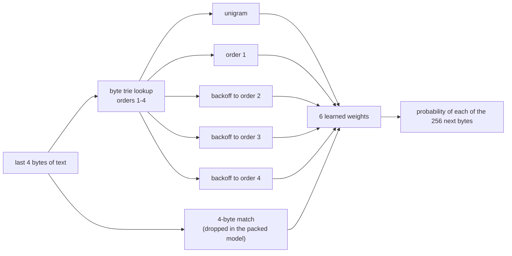

# CyphaLM's 1 TB byte trie: how it works and how it performs

**Date:** 2026-11-01. This explains the model from the ground up and puts every measurement in one place. The detailed run log, the checksums and the reproduce commands are in [`TRIE_1TB_PROFILE.md`](TRIE_1TB_PROFILE.md). The packed model is in [`models/cyphalm_1tb/`](../../models/cyphalm_1tb/README.md).

---

## The answer in one page

**What it is.** CyphaLM's 1 TB model is an **order-4 byte trie**. It reads text one byte at a time. To guess the next byte, it looks up the last 1 to 4 bytes in a table of every context it has seen, together with which bytes followed that context and how often. Nothing is learned except those counts and six blending weights. There is no neural network, no tokenizer and no gradient descent over the text.

**What it was trained on.**

- **Text:** 918.6 GB of text from 976 checksum-verified files: C4 web pages 625 GB, GitHub code 224 GB, arXiv papers 94 GB, Stack Exchange 80 GB, and 40 Gutenberg books.
- **Two copies:** it was trained twice, and both copies agree to within 0.004 bits per byte.
  - Model 1 used 64-bit counts and took 48 h on 8 threads.
  - Model 2 used 32-bit counts that halve instead of overflowing, and took 26.5 h on 32 threads.

**How big it is.**

- **Trained form:** 12.4 GB, with 53.8 million contexts and 574 million follower counts.
- **Packed serving form:** 992 MB (465 MB compressed), loaded in about 1 GB of RAM.
- **Sampling speed:** about 13–19 µs per byte on one core, loaded in a few seconds.

**How well it predicts.** It is measured in **bits per byte (BPC)**, lower is better. 8 bits per byte would mean knowing nothing.

| Text it has never seen | 1 TB trie | 8 MiB wiki trie |
|---|---:|---:|
| Web pages (unseen C4 shard) | **2.18** | 2.63 |
| A technical report in plain English (lcet10) | **2.33** | 2.98 |
| Clean Wikipedia prose (GEN-A continuations) | **2.25** | 2.40 |
| Raw 2006 Wikipedia XML (enwik9 holdout) | 3.21 | **2.30** |
| Inside CyphaLM's full stack (InfiniGram, Kneser–Ney, class, similar-context, copy, doc cache), enwik holdout | **1.691** | 1.697 |

**The four things to remember.**

1. **The terabyte buys about half a bit per byte, on the kinds of text it contains.** It does not help on kinds of text it lacks: there was no Wikipedia markup in it, so it loses badly on raw wiki XML.
2. **Within one kind of text, the model is full after about 1 GB.** Model 2's snapshots show unseen web text at 2.299 BPC after 0.77 GB of web text, and 2.285 after 918.6 GB. Four bytes of context can only say so much. Past about a gigabyte, more of the same text is close to worthless.
3. **It writes word salad.** SCRIBE v2, the repo's generation score, gives it 0.028 on its own (8 MiB trie: 0.020). In the full stack it scores 0.113 (8 MiB stack: 0.135), against 0.923 for human text. The words are real; the sentences are not.
4. **It answers no unseen questions.** 0 of 41 held-out questions, the same as the 8 MiB trie. A table of 4-byte contexts has no way to connect a question to a fact.

---

## 1. How the model works

### 1.1 The idea: count what follows each context

Take the text `the cat sat on the mat`. After the 4 bytes `the ` (t, h, e, space), the next byte was `c` once and `m` once. After `he c` it was `a`. A byte trie stores exactly this, for every context of length 1 to 4 bytes seen in the training text:

```
context (last bytes, newest first)      followers seen, with counts
"␠"                                     t:…, c:…, s:…, o:…, m:…
"e␠"                                    c:…, m:…, …
"he␠"                                   c:…, m:…, …
"the␠"                                  c: 1, m: 1
```

It is a tree whose paths spell contexts backwards: the root, then the last byte, then the byte before it, and so on. Each node holds its followers and their counts. After 918.6 GB the tree holds:

| Order (context length) | Contexts | What that means |
|---|---:|---|
| 1 | 163 | Only 163 of 256 byte values ever appeared. Non-ASCII was dropped (§7) |
| 2 | 10,140 | Of 65,536 possible byte pairs |
| 3 | 916,490 | Of 16.8 million possible triples |
| 4 | 52,886,719 | Of 4.3 billion possible 4-byte strings: 1.2% of the space |
| Follower counts | 574,113,056 | About 11 different next bytes per context, on average |

Only 1.2% of possible 4-byte strings ever occur in real text, and that is why a table this simple fits.

### 1.2 Turning counts into a probability: backoff

A context seen thousands of times gives a confident, sharp distribution. A context seen once says little, and an unseen next byte must not get probability zero, or the model would be infinitely surprised. So the model blends orders by **stupid backoff** (alpha 0.4):

1. **Base.** Start from the order-1 table: a KT-smoothed estimate of which byte follows the last byte, `(count + 0.5) / (total + 128)`. If that is missing, use the unigram (overall byte frequencies).
2. **Orders 2, 3 and 4 in turn.** If the context exists, each byte it has seen gets `count / total`. Every byte it has not seen keeps 0.4 times its probability from the shorter order.
3. **Renormalise** so the 256 probabilities sum to 1.

The longest context that matches dominates, and shorter ones fill in what it has never seen.

### 1.3 The mixture: six experts and six weights

On top of the backoff, a small **mixture** blends six "experts":

- the unigram;
- order 1;
- the backoff stopped at order 2, 3 and 4;
- a 4-byte **match** expert, which bets on the byte that followed this exact 4-byte context most recently.

Six weights are learned by exponentiated gradient on a training stream, then frozen.



At 1 TB the weights end up almost entirely on order 4. The packed model's weights, fit on enwik9 `[0, 7340032)`, are:

| Unigram | Order 1 | Order 2 | Order 3 | **Order 4** | Match |
|---:|---:|---:|---:|---:|---:|
| 0.0001 | 0.0040 | 0.0018 | 0.0528 | **0.9412** | 0.0001 |

Fit on web text the order-4 weight is 0.9995, and on lcet10 0.923. **The model is, in practice, order-4 backoff.**

### 1.4 Why the match expert was removed

At 8 MiB the match expert earned weight 0.06. At 1 TB it is worse than useless. It remembers only the *latest* follower of each 4-byte context, and after 918 GB of mixed text the latest follower is close to random: it fires on 99% of bytes and is right only 33–43% of the time. Every score improves by 0.10–0.15 BPC without it, and the packed model leaves it out.

### 1.5 The packed model

Training keeps everything: every context, every count, 64-bit numbers and linked lists. The **packed** form (`packed_trie.hpp`'s `PackedModel`, written by `trie_ckpt pack`) keeps only what serving needs:

- **Followers:** followers seen at least twice, each count stored in **one byte** on a geometric scale (exact to 64, then steps of 8%). A node's counts are first shifted down until its total fits that scale (at most 155 million). That shift keeps every ratio; it moved 2,389 nodes by up to 8 bits.
- **Nodes:** the nodes on paths to those followers, laid out breadth-first with children sorted by byte. There are no pointers, so a lookup is a binary search.
- **Tables:** the unigram and order-1 tables, and the six weights.

| | Trained (`TR64`) | Packed |
|---|---:|---:|
| File | 12.38 GB | **992 MB** (465 MB with zstd -19) |
| Contexts | 53.8 M | 41.8 M |
| Followers | 574 M | 390 M |
| Load | 77–92 s from `D:` (model 2, widened from 32 bits: 188 s) | a few seconds (a whole 250-prompt `sample` run, load included, took 15 s) |
| Resident | 12.3 GB | about 1.0 GB |
| BPC, unseen C4 / lcet10 / enwik9 | 2.173 / 2.337 / 3.206 | 2.180 / 2.328 / 3.207 |

Packing costs nothing measurable. Dropping followers seen once even helps a little on text far from the training data.

---

## 2. How it was built

### 2.1 The corpus

`scripts/fetch_corpus.py` downloaded about 1 TB to `D:\cypha_llm\corpus`. What was trained:

| Category | Files | On disk | Source |
|---|---:|---:|---|
| Web articles | 739 | 625.1 GB | RedPajama C4, shards 00000–00738 |
| Code | 96 | 224.1 GB | RedPajama GitHub |
| Papers | 100 | 93.8 GB | RedPajama arXiv (LaTeX) |
| Q&A | 1 | 80.0 GB | RedPajama Stack Exchange |
| Books | 40 | 0.03 GB | Project Gutenberg |
| **Total** | **976** | **1,023 GB** | **918.6 GB of text once the JSON wrapping is removed** |

**Not in it:**

- **Wikipedia, Wikisource and Wikibooks.** They are bz2 XML, which the trainer does not read, and the English Wikipedia download never finished.
- **RedPajama Common Crawl and the WET sample.** The articles cap filled first.
- **Most of Gutenberg.** The site started refusing plain requests.
- **Chat data.** Kept out by design.
- **Non-ASCII characters inside JSON text.** The JSON reader drops `\uXXXX` escapes.

### 2.2 Checked byte for byte

Every RedPajama file was checked against RedPajama's published SHA-256 lists, and the Wikimedia dumps against their SHA-1 lists (`scripts/verify_corpus_sha.py`). 918 files matched the first time. 18 were truncated downloads, where a dropped connection had been saved as finished; those were fetched again until they matched. The fetcher now refuses a short download.

### 2.3 Trained twice

| | Model 1 | Model 2 |
|---|---|---|
| Trainer | `trie_stream_train.cpp` | `trie_stream_train_v2.cpp` |
| Counts | 64-bit, exact (`TR64`) | 32-bit, halving at 2³² (`TRI2`) |
| Threads | 8 | 32 |
| Time | about 48 h | 26.5 h |
| Snapshots | none | 0.77, 1.5, 11.5 and 108 GB |
| Checkpoint | 12.38 GB | 9.87 GB |
| Text seen | 918,559,319,258 bytes | 918,558,796,802 bytes |
| Contexts / followers | 53,813,513 / 574,113,056 | 53,813,499 / 574,109,539 |

The 522,456-byte difference is 12 checksum lists that model 1 read by mistake. The trainers now skip that folder.

**Parallel training.** Each corpus file is cut into one byte range per thread. Each thread builds its own small trie, and the tries are merged pairwise in parallel, then into the main model. On JSON-lines files this gives exactly the same model as one thread; the self-test confirms that in 22,342 checks. One C4 file takes 88 s on 8 threads and 39 s on 32.

**Two ways to stop counts overflowing.** An earlier run used 32-bit counts that **wrapped**: its unigram total was the true count minus a multiple of 2³². That model was deleted.

- **Model 1** stores 64-bit counts, which never wrap.
- **Model 2** halves a table when a count would pass 2³². Halving keeps ratios, but it also **weights recent text**. A table halved k times counts its older data at 2⁻ᵏ.
  - Model 2's unigram was halved 383 times, so it reflects the last few gigabytes (Stack Exchange). Its unigram entropy is 5.09 bits, against 4.84 over the whole corpus.
  - Order-1 rows were halved 334 times and contexts 136 times.
  - The order-4 contexts that carry the model almost never halve, so the two models score the same.

### 2.4 Verified

`trie_ckpt verify` checks:

- every link, depth and child count;
- every total against its followers' sum, exactly for 64-bit counts;
- the unigram total against the bytes seen;
- that every finished corpus file was trained.

Both models pass all of it. The one problem reported is the unfinished Wikipedia download. Model 2 against model 1 (`trie_ckpt compare`): −0.0113 to −0.0154 BPC with full counts and the match, and within ±0.01 packed. They are the same model.

---

## 3. How well it predicts

### 3.1 What a BPC number means

BPC is the average of −log₂ of the probability the model gave to each true next byte. That is how many bits a compressor driven by the model would need per byte.

| Reference point | BPC | Notes |
|---|---:|---|
| Knowing nothing (uniform over 256) | 8.00 | |
| Byte frequencies only (this model's unigram) | 4.6–5.7 | |
| gzip -9 on enwik8 | about 2.92 | Whole-file compression, adaptive (Large Text Compression Benchmark) |
| bzip2 -9 on enwik8 | about 2.32 | Same |
| **1 TB trie on unseen web text** | **2.18** | Frozen: it does not learn from the text it scores |
| CyphaLM's full stack, enwik holdout | 1.69 | |
| hp gate24, enwik8 | 1.61 | Adapts to the file as it reads |
| Byte-level Transformers on enwik8 (published) | about 1.0 | GPUs, days of training |

The compressor figures adapt to the file they compress, and this trie does not, so the comparison is rough. It does show the scale: alone, the 1 TB trie predicts held-out web text about as well as bzip2 compresses Wikipedia.

### 3.2 Held-out text, every number

From the profiler (`trie_stream_profile`): six weights fit on the first part of each text, then the next part scored with every count frozen.

| BPC | enwik9 holdout | enwik9 @ 200 MB | Unseen C4 | lcet10 |
|---|---:|---:|---:|---:|
| Unigram | 5.695 | 5.329 | 4.605 | 5.041 |
| Order 1 | 4.434 | 4.307 | 3.776 | 4.006 |
| Backoff to order 2 | 4.057 | 3.782 | 3.115 | 3.300 |
| Backoff to order 3 | 3.651 | 3.273 | 2.550 | 2.650 |
| Backoff to order 4 | 3.281 | 2.907 | **2.173** | 2.321 |
| Fixed blend with the match | 3.431 | 3.045 | 2.297 | 2.423 |
| **Learned mixture, model 1** | **3.206** | **2.878** | **2.173** | **2.337** |
| Learned mixture, model 2 | 3.203 | 2.877 | 2.173 | 2.334 |
| Packed, model 1 / model 2 | 3.207 / 3.205 | 2.880 / 2.878 | 2.180 / 2.180 | 2.328 / 2.329 |
| Top-1 accuracy (the likeliest byte is right) | 43.6% | 47.6% | **54.1%** | 57.1% |
| Mixture entropy, bits | 2.57 | 2.46 | 2.24 | 2.14 |
| Bytes whose 4-byte context is in the trie | 98.6% | 99.4% | 100.0% | 99.8% |

Each extra byte of context removes 0.4–0.8 bits per byte. On web text the drops are 4.6 → 3.8 → 3.1 → 2.6 → 2.2, and order 4's step (0.38) is already the smallest. On web text the model's top guess is right more than half the time.

### 3.3 Against the 8 MiB trie: domain is everything

The 8 MiB trie is CyphaLM's usual trie, trained on enwik9's first 7 MiB of Wikipedia XML. Both packed models were scored on the same bytes:

| BPC | 8 MiB wiki trie (4.1 MB) | 1 TB trie (992 MB) | Difference |
|---|---:|---:|---:|
| enwik9 holdout | **2.298** | 3.207 | +0.909 |
| enwik9 @ 200 MB | **2.440** | 2.880 | +0.440 |
| Unseen C4 | 2.627 | **2.180** | −0.447 |
| lcet10 | 2.984 | **2.328** | −0.656 |
| Clean Wikipedia prose (GEN-A continuations) | 2.404 | **2.252** | −0.152 |

Each trie wins on its own kind of text. On its own domain, each lands near 2.2–2.3. The 1 TB trie is not better at Wikipedia markup, because it saw almost none (`[[`, `{{`, `&quot;`, `<revision>`). It is better at everything else.

### 3.4 The scaling curve: when does more data stop helping?

Model 2 kept copies of itself as it trained. Each was scored with the same fixed backoff (full counts plus the match, so the numbers sit about 0.1 above the learned mixture):

| Text seen | 0.77 GB | 1.5 GB | 11.5 GB | 108 GB | 918.6 GB |
|---|---:|---:|---:|---:|---:|
| What it holds | C4 | C4 | C4 | C4 | + code, papers, Stack Exchange, books |
| Unseen C4 | 2.299 | 2.287 | 2.287 | **2.282** | 2.285 |
| lcet10 | 2.871 | 2.872 | 2.910 | 2.977 | **2.412** |
| enwik9 holdout | 4.086 | 4.065 | 4.011 | 3.978 | **3.403** |
| enwik9 @ 200 MB | 3.598 | 3.557 | 3.506 | 3.478 | **3.028** |

- **Saturated by about 1 GB.** On unseen web text, 0.77 GB of web text already gives 2.299. 140 times more (108 GB) gains 0.017. A power-law fit \(L(n) = L_\infty + a\,n^{-b}\) puts the floor at about \(L_\infty \approx 2.28\).
- **Coverage, not volume.** More C4 makes lcet10 *worse* (2.87 → 2.98), because the match table drifts toward web text. When code, papers and Stack Exchange arrive, lcet10 drops 0.57 and wiki 0.58.
- **Why.** An order-4 model can only learn which byte tends to follow each 4-byte string. In one kind of text, those statistics are fully estimated within about a gigabyte. Everything a longer context would tell it is invisible to it.

### 3.5 Inside CyphaLM's full stack

CyphaLM normally runs the trie together with experts built on the training slice. `context8k` measures the holdout's second half after each expert is added. Every expert is the same in both columns; only the trie differs.

| BPC, enwik holdout second half | 8 MiB trie | 1 TB trie |
|---|---:|---:|
| Trie alone | **2.316** | 3.115 |
| + byte Kneser–Ney (BKN, built on wiki train) | **2.029** | 2.045 |
| + InfiniGram, context up to 8,192 bytes | 1.918 | **1.917** |
| + class expert | 1.893 | **1.888** |
| + similar-context expert | 1.773 | **1.766** |
| + copy expert | 1.726 | **1.719** |
| + document cache (**today's default**) | 1.697 | **1.691** |
| Time / peak memory | 21.5 min / 213 MB | 12.3 min / 1.17 GB |

The experts are built on wiki text, so they fill in what the 1 TB trie lacks: Kneser–Ney alone takes it from 3.115 to 2.045. From there, the trie's broader knowledge makes the whole stack slightly better than the 8 MiB stack, by 0.0065. That difference is small, and `context8k` gives no interval for it.

The 1 TB trie needs no training at run time, so `context8k` finishes faster. It loads the 992 MB packed file instead of building the trie, so it uses more memory.

**Without the experts, InfiniGram alone** (trie plus InfiniGram over wiki and Dolly, no Kneser–Ney): 2.2757 for the 1 TB trie (model 2: 2.2749) against 2.0684 for the 8 MiB trie. The 8 MiB trie was also trained on that wiki text and Dolly, and its counts reinforce the index.

---

## 4. What it knows: next-byte examples

`trie_ckpt top MODEL.pk CONTEXT` prints the six likeliest next bytes, the entropy, and a greedy continuation (always taking the likeliest byte). Packed models, learned mixture:

| Context | 8 MiB wiki trie | 1 TB trie |
|---|---|---|
| `#include <` | `/` 0.75 → greedy `/contributor>` (wiki XML) | `s` 0.22, `a` 0.09, `b` 0.07 → `string` |
| `http://www.` | `a` 0.19 → `animal Farm of the [[Alaska…` | `w` 0.13 → `w3.org/apache.…` |
| `</` | `t`, `i` 0.23 each → `timestamp>` | `s` 0.17 → `span></a></li>` |
| `def ` | `n` 0.29 → `name>` | `t` 0.14, `_` 0.14 → `test` (or `__init__`) |
| `begin{` | `m` 0.72, `c` 0.22 → `matrict` | `e` 0.36, `a` 0.17 → `equation` |
| `[[` | `1` 0.09, `A` 0.08 → `1981]] - [[John…` | `N` 0.10, space 0.08 → `NSMutable…` |
| `In 19` | `9` 0.21, `7` 0.15, `8` 0.12 | `9` 0.26, `8` 0.16, `7` 0.13 |
| `the United States of ` | `t` 0.33 | `t` 0.31 |
| `User: What is the capital of France?\nAssistant: ` | `t` 0.18, `[` 0.18 → `the [[Alaska…` | `"` 0.18 → `"\e013", "");` |

- **Each model is a snapshot of its corpus.** The 8 MiB trie thinks everything is Wikipedia XML: `#include <` turns into a `</contributor>` tag. The 1 TB trie has seen C++ (`<string>`), HTML (`</span>`), LaTeX (`\begin{equation}`), Python (`def test`, `__init__`), Objective-C (`NSMutable`) and URLs (`www.w3.org`).
- **Neither knows a fact.** After the France question, the 1 TB trie expects a quote mark, the start of a JSON or code string, because "Assistant: " followed by a quote is common in code. It has no idea Paris is the answer.
- **Greedy decoding loops.** Always taking the likeliest byte locks onto a cycle within a few words. The 1 TB trie falls into `the state the state the state …`, and the 8 MiB trie into `the [[Alaska has been the [[Alaska …`. With 4 bytes of memory, once the text returns to a 4-byte string it has already written, it repeats. That is why sampling uses temperature, a nucleus and a repeat ban.
- **Entropies of 3–5.7 bits at these short prompts.** The models are genuinely unsure after `The `. It is the frequent, sharp contexts deep inside words that make the average about 2.2.

---

## 5. Generation

### 5.1 Samples

Temperature 0.8, nucleus 0.9, an 11-byte repeat ban, with weights fit on C4 (model 1):

> The Count of stuff, so income allow to be able for the money or with the most efficular is a lated the close of relieve that in a process the same time to make a chall probably seconomy of the up of poten

> In 1952.\nBut the used out of the new large amouseholding the of the pression in a serience to ensure to get that will be addition for some of the for work. What I this back to the for and that are that can

Model 2, from the same prompts with weights fit on lcet10:

> In 1952.\nWhich as a lot of the very of the rolested are and size > 0) {\n            <message, he home environment post positional for example, and can resource.r…

Most words are real, but nothing holds together past three or four words. Code and LaTeX break into prose (`size > 0) {`, `<message`, `$M$`), because four bytes cannot tell a Python file from a news article.

### 5.2 SCRIBE v2 (the repo's generation score)

SCRIBE v2 scores generated text by its distance from human text of the same kind. It looks at vocabulary, sentence form, coherence and integrity. On its control ladder, human text scores 0.923 and sentences shuffled across documents score 0.344.

GEN-A dev: 250 prompts of clean Wikipedia prose, each sampled at temperatures 0.6, 0.8 and 1.0 (750 samples).

| | SCRIBE v2 [95%] | Surface S | Human continuations, BPC | Copy share |
|---|---:|---:|---:|---:|
| 8 MiB trie alone | 0.020 [0.014, 0.027] | 0.737 | 2.404 | 0.003 |
| 1 TB trie alone (model 1) | 0.028 [0.021, 0.035] | 0.796 | **2.252** | 0.000 |
| 1 TB trie alone (model 2) | 0.032 [0.023, 0.041] | 0.798 | **2.252** | 0.000 |
| 8 MiB trie, full default stack | **0.135 [0.116, 0.153]** | 0.896 | 2.055 | 0.044 |
| 1 TB trie, full default stack | 0.113 [0.097, 0.131] | 0.892 | **2.015** | 0.036 |

- **Alone, the 1 TB trie is slightly better and still word salad.** Its words are more often real, so surface S rises. SCRIBE's intervals overlap with the 8 MiB trie's.
- **In the full stack the two are tied.** The 1 TB stack is a little lower on SCRIBE, but the intervals overlap. It predicts the human continuations 0.04 bits per byte better, and copies less (3.6% against 4.4%). The experts, built on wiki text, put wiki markup back into its samples.
- **The trie is not what holds generation back.** The stack reaches 0.11–0.14 with either trie, against 0.92 for human text. Both stacks fail on sentence form and coherence: SCRIBE's sentence distance stays around 18 of 23. A model that sees 4 bytes of context cannot plan a sentence.

### 5.3 Speed

| | µs per generated byte | Notes |
|---|---:|---|
| 1 TB trie alone | 13–19 | One core; a binary search per order |
| 8 MiB trie alone | 15 | |
| Full stack, 1 TB trie | 585 | Similar-context and copy experts dominate |
| Full stack, 8 MiB trie | 651 | |

---

## 6. Questions and answers

`context8k` asks 50 questions. Some it has seen (Dolly turns that are in its InfiniGram index) and 41 it has not: 30 held-out Dolly turns, 8 Wikipedia facts and 3 paraphrases. An answer counts if its greedy 150 bytes contain the expected text.

| Questions | 8 MiB trie | 1 TB trie | 1 TB, full stack |
|---|---:|---:|---:|
| Seen Dolly turns | 3 / 3 | 3 / 3 | 3 / 3 |
| Seen, first letter changed | 3 / 3 | 3 / 3 | 3 / 3 |
| Seen, " Thanks." added | 0 / 3 | 0 / 3 | 0 / 3 |
| Paraphrased | 0 / 3 | 0 / 3 | 0 / 3 |
| Held-out Dolly turns | 0 / 30 | 0 / 30 | 0 / 30 |
| Wikipedia facts | 0 / 8 | 0 / 8 | 0 / 8 |

The "seen" answers come from InfiniGram copying Dolly's stored answer. One extra word ("Thanks.") breaks the copy. **No configuration answers a single question it has not seen.** That matches the plan's prediction P-A4 (≤ 2%): nothing in a byte trie links a question to an answer it did not store word for word.

---

## 7. Strengths, weaknesses, and why

**Strengths**

- **Broad.** It has seen web pages, code in many languages, LaTeX, HTML and Q&A. Off Wikipedia it is 0.45–0.66 BPC better than the 8 MiB trie.
- **Cheap to serve.** 992 MB, loaded in a few seconds, 13–19 µs a byte on one core, and no GPU.
- **Exact and inspectable.** Every probability comes from counts you can print (`trie_ckpt top`). Training is deterministic, and the parallel trainer reproduces the serial one exactly.
- **Fits in the stack.** With CyphaLM's experts it gives the best enwik holdout score measured here (1.691), and it needs no training at run time.

**Weaknesses**

- **Four bytes of memory.** It cannot see a word boundary five letters back, let alone a sentence. This caps quality near 2.2 BPC on any domain, however much text it reads.
- **Domain-bound.** It is poor on kinds of text it lacks: raw wiki XML at 3.21.
- **No knowledge, no reasoning.** It has 0 of 41 unseen questions, and nothing in it represents a fact.
- **Word salad.** SCRIBE 0.03 alone and 0.11 in the stack, against 0.92 for human text.
- **Missing data.** No Wikipedia, and no accented letters or non-Latin scripts, because the JSON reader drops `\uXXXX`.
- **Model 2's recency bias.** Halving makes its unigram and order-1 tables mostly reflect the last few GB (Stack Exchange). Model 1's 64-bit counts do not have this.

**Why it behaves this way.** A byte trie is a Markov chain of order 4. It is the best possible model of "the next byte, given the previous four", estimated from counts. With enough text those counts are nearly exact, so the model is at its ceiling for that context length. The 2.2 BPC floor is roughly how much uncertainty remains in English and code when you can see only four bytes back. Lowering it needs more context, not more counts.

---

## 8. What would make it better

| Change | Expected effect | Evidence |
|---|---|---|
| **Longer context:** InfiniGram over the big corpus (sharded suffix array), packed orders 5–6 (A7), byte Kneser–Ney at scale | Large. Beats the 4-byte ceiling | InfiniGram −0.25 to −0.84; Kneser–Ney −0.29 to −1.07 in `context8k` |
| **Add Wikipedia** (bz2 reader, finish the download) | Large on wiki text; P-A1 and P-A2 depend on it | 8 MiB of wiki already beats 918 GB of non-wiki on wiki |
| **Keep non-ASCII** (decode `\uXXXX`) | Covers accented and non-Latin text | 93 of 256 byte values never seen |
| **More of the same text** | Almost none | Scaling curve: +107 GB of C4 gives −0.017 |
| **Per-domain experts with a router** (A8) | Probably moderate | Each trie wins on its own domain |
| **Generation planning** (content plans, sentence gates) | Needed for readable text | Tried in GEN-B and GEN-E; SCRIBE has not moved past about 0.15 |

---

## 9. How to use it

```bash
# Get the packed model (Git LFS) and check it
git lfs pull --include models/cyphalm_1tb/trie_1tb.pk.zst
zstd -d models/cyphalm_1tb/trie_1tb.pk.zst -o trie_1tb.pk
sha256sum -c models/cyphalm_1tb/SHA256SUMS --ignore-missing

bash scripts/build_1tb_tools.sh                    # builds into ~/bin
~/bin/trie_ckpt top trie_1tb.pk "#include <" "http://www." --k 6
~/bin/trie_ckpt bpc trie_1tb.pk some_text.txt       # BPC of any file
~/bin/cyphalm_trie sample enwik8 out.txt --model trie_1tb.pk --no-sim --no-copy --no-bkn
~/bin/cyphalm_trie context8k enwik8 dolly.jsonl --model trie_1tb.pk   # inside the full stack
```

The trained checkpoints stay on the training machine: model 1 (`TR64`, 12.4 GB) at `D:\cypha_llm\corpus\trie\checkpoint.bin`, and model 2 (`TRI2`, 9.9 GB, with snapshots) in `…\trie\model2\`. Model 2's packed form is there too (`trie_model2.pk`). It is the same model as the one in git, so it is not committed.

---

## 10. Where every number comes from

| Measurement | Tool | Raw output (`D:\cypha_llm\profile\`) |
|---|---|---|
| Structure, held-out BPC, samples (model 1) | `trie_stream_profile` | `enwik9.txt`, `c4_heldout.out`, `lcet10.out` |
| Structure, held-out BPC, samples (model 2) | `trie_stream_profile` | `model2/profile_*.txt` |
| Verify, compare, snapshots | `trie_ckpt verify / compare / bpc` | `verify_tr64.txt`, `model2/verify.txt`, `model2/compare_1_2.txt`, `model2/bpc_*.txt` |
| Packed BPC (1 TB, 8 MiB) | `trie_ckpt bpc` | `bpc_pk.txt`, `bpc_8m.txt`, `model2/bpc_pk.txt` |
| InfiniGram, questions, full stack | `cyphalm_trie context8k` | `ctx8k_*.out`, `model2/ctx8k_*.out` |
| Generation | `scripts/gen_eval.sh` (SCRIBE v2) | `gen/*.summary.md`, `model2/gen*/*.summary.md` |
| Next-byte examples | `trie_ckpt top` | `model2/top.txt` |

All scoring text is held out from the trie it scores.

- The C4 slice is shard `01023`, which was never downloaded for training.
- lcet10 is not among the 40 books.
- enwik9 and the GEN-A prompts are Wikipedia, which the 1 TB corpus does not contain. C4 is a web crawl, though, and may hold copies of some Wikipedia pages.
