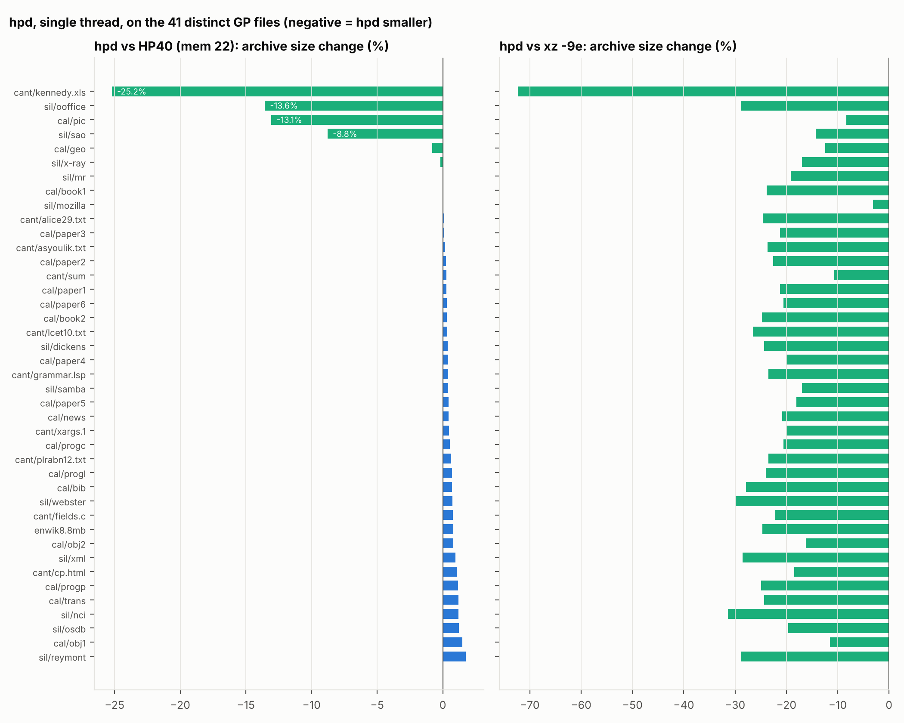
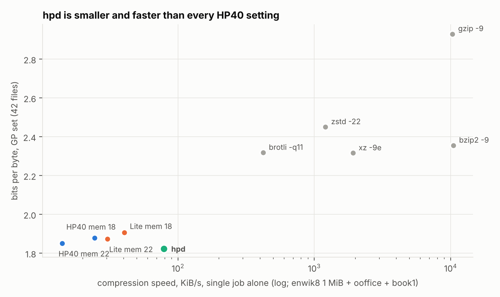

# Part II — hpd: turning HP40 into a day-to-day compressor

**Author:** Odin Loch (with Claude Code) · **Date:** 2026-11-04 · **Code:** [`compress/hpd/`](../../compress/hpd/)
**Follows:** [`HP40_paper.md`](HP40_paper.md) (Part I: profiling and data-mining HP40 / HP40-Lite)

Part I found that HP40 compresses general data 20% better than xz -9e but is
unusable day to day. It runs at 8 KiB/s, commits 10.6 GiB to every file,
spends most of its time waiting on DRAM, and is weak on binary records,
executables and images. **hpd** is HP40-Lite rebuilt around those
measurements. Every change below was profiled before it was made and
measured after.

**Results.**

| | GP set (42 files, 27 MB) | full Silesia (212 MB) | speed, 1 thread, same machine* | peak RAM |
|---|---:|---:|---:|---:|
| **hpd** | **1.823 bpc** (−21.3% vs xz -9e) | **1.474 bpc** (−19.4% vs xz -9e) | **78.6 KiB/s** | 0.6 GiB (1 thread) |
| HP40, `--mem 22` | 1.851 bpc (−20.1%) | not run | 14.2 KiB/s | 10.6 GiB |
| HP40-Lite, `--mem 22` | 1.874 bpc (−19.1%) | not run | 30.3 KiB/s | 6.2 GiB |
| xz -9e | 2.316 bpc | 1.829 bpc | 1,924 KiB/s | 76 MiB |

\*enwik8 1 MiB + Silesia ooffice + Calgary book1, one job alone on the VM (Table 3).

hpd is **1.55% smaller than HP40 and 2.7% smaller than HP40-Lite**, while
running **5.6× faster than HP40 and 2.6× faster than Lite** in **1/18 of
HP40's memory**. It writes the smallest archive of all tested compressors on
40 of 41 distinct GP files and on all 12 full Silesia files. The one GP loss
is a 13 KB English paper, where brotli's built-in dictionary wins by 38 bytes.
The x86, record-structured and image files where HP40 was weakest are now
its largest wins. On text it remains 0–1.8% behind full HP40. Every
archive in every run decoded byte-exactly.

## 1. Method

* **Base.** HP40-Lite's 134 compile switches were resolved with `unifdef`
  (3,977 lines, no `#if` left). The stripped tree writes byte-identical
  archives to the HP40-Lite binary (checked on three files).
* **One change at a time.** Each change was built as its own binary and
  measured on the 13-file tuning set from Part I (ratio, single thread,
  4 jobs in parallel) and for speed on enwik8 1 MiB + Silesia `ooffice` run
  alone, with a full round trip. Changes that should not alter the output
  (*exact*) were checked byte-for-byte.
* **Final evaluation.** The same 42-file GP set as Part I, single thread,
  one job alone on the machine; then the full 212 MB Silesia corpus with
  4 threads, the way a user would run it; then clean single-job timings of
  HP40, Lite and hpd on the same three files on the same machine (the VM
  was replaced mid-study by a faster one, so Part I's timings are not
  directly comparable to hpd's).

## 2. Speed: removing the DRAM wait

Part I's profile put 95% of `ContextModel::predict` on one load,
`t_[idx_]`: one random DRAM access per context model per bit, about 30 per
bit. The fix is the classic one from paq8/lpaq, adapted to HP's two-output
models:

* **Bucketed tables.** Each context gets one 32-byte bucket per *nibble*: a
  16-bit checksum and 15 bit-history slots, one per node of the nibble's
  binary tree. Two buckets share a 64-byte cache line as a 2-way set; on a
  miss the bucket whose first-bit history has seen fewer bits is replaced.
  A model now touches 2 cache lines per byte instead of 8 random slots.
* **Prefetch.** Each model computes its bucket address when its context is
  set (byte boundary) and again right after bit 3. Every model issues its
  load before any model predicts, so ~16 loads overlap instead of queueing.
* **Checksums.** HP40 had none, so unrelated contexts shared statistics.
  This is why HP40 always wanted bigger tables (Part I: kennedy.xls was 22%
  worse at `--mem 16`). With checksums, ratio *improved* by 0.72%.

After bucketing, `ContextModel::predict` fell from 35% of CPU to about 3%,
and the profile became compute-bound. The next items were exact
arithmetic fixes:

| step | what | output | speed |
|---|---|---|---:|
| 1 | bucketed, checksummed, prefetched tables | −0.72% (tuning set) | ×1.6 – 1.9 |
| 2 | `log2_q16`: 4,097-entry table instead of a 16-step squaring loop (called ~15× per bit by the Hedge layer, discovery-pool MDL and GRIA) | *exact* | ×1.57 |
| 3 | Pitman–Yor estimate: 13×13 table + reciprocal multiply instead of two 64-bit divides (verified on all 692,224 inputs) | *exact* | ×1.18 |
| 4 | mixer: AVX2 64-bit dot product, 32-bit update (provably no overflow at lr ≤ 4) | *exact* | ×1.02 |
| 5 | per-model growth cap (`-g 2`, see §3) | +0.03% | ×1.14 |

Steps 1–5 together: **×3–3.5 single-thread** at equal table size (enwik8 + ooffice at `--mem 18`: 24.9 → 73.4 KiB/s). After
step 4 the profile is flat; no line is above ~5%. The remaining cost is the
work itself: 11 layer-1 mixers × 52 inputs, ~20 bucketed context models
and their state-map updates. Further speed must come from doing less, or from more
cores.

## 3. Memory and start-up

| change | effect |
|---|---|
| **demand-zero tables** (`mmap` / `VirtualAlloc`) instead of value-initialised `std::vector` | start-up 17–36 s → ~0; untouched table pages cost nothing |
| **one shared match history** instead of 11 private copies | −10 history buffers |
| **growth cap** `-g 2`: a model's table may grow at most 2 bits above the base (HP40 let word tables grow 9 bits, to 2³¹ slots) | RSS on 1 MiB: 1.92 GiB → 0.54 GiB, +0.03% size |
| **auto table size**: base table ≈ 4× the block | small files get small tables; ratio equal to `--mem 22` within 0.15% |

Demand-zero alone does not solve memory: random touches into a 4 GiB table
dirty most of its pages even on a 1 MiB input. The cap is what bounds RSS.

## 4. Ratio: models for data HP40 never saw

Part I's weakest files were binary records (`sao`, `kennedy.xls`, `osdb`),
executables (`ooffice`) and a fax bitmap (`pic`, where xz won). The
expert-mining had shown that HP40 adapts to such data only through its
discovery pool. hpd adds explicit models instead:

| change | tuning set | headline file | speed |
|---|---:|---|---:|
| **record model**: detects a fixed record length online (a byte recurring at the same distance 4× running votes for that period; a period is adopted after 16 votes) and adds 3 bucketed contexts: above+above², above+left, column+above | **−2.24%** | kennedy.xls −40%, sao −11% | −4% |
| mixer weight set selected by relative position inside the record | −0.26% | sao −1.6% more | −3% |
| word-bigram model restored (Lite had dropped it; affordable now) | −0.14% | dickens −0.7% | −3% |
| **x86 CALL transform**: E8 operands in ±2²⁴ rotated by position mod 2²⁵ (a bijection), on blocks whose call targets repeat | — | ooffice **−14.0%** | — |
| stored blocks; stop modelling data that has expanded for 1 MiB | random data: input + 30 B | — | — |

Measured and **rejected** (not worth their cost):

| tried | result |
|---|---|
| 12 discovery slots instead of 4 | −0.40%, −23% speed → kept as `-9`, not default |
| 2-D raster context on the record model | −0.03% |
| 4th APM on a hashed order-2 / order-3 context | −0.04% / 0.00% |
| fewer discovery slots (1–2) as a fast mode | +0.2%, only +7% speed |

## 5. Results on the GP set (42 files, single thread)

**Table 1. GP set, archive bytes (bits per byte), single thread.**

| compressor | Calgary | Canterbury | Silesia-1M | enwik8.8mb | **total** | vs xz -9e |
|---|---:|---:|---:|---:|---:|---:|
| **hpd** | **694,158** (1.708) | **355,495** (1.012) | **3,374,326** (2.145) | 1,735,211 (1.655) | **6,159,190 (1.823)** | **−21.3%** |
| HP40 (mem 22) | 697,974 (1.717) | 364,487 (1.037) | 3,472,235 (2.208) | **1,721,462** (1.642) | 6,256,158 (1.851) | −20.1% |
| HP40-Lite (mem 22) | 704,110 (1.732) | 372,811 (1.061) | 3,514,543 (2.234) | 1,740,566 (1.660) | 6,332,030 (1.874) | −19.1% |
| xz -9e | 883,752 (2.174) | 493,080 (1.403) | 4,147,436 (2.637) | 2,303,468 (2.197) | 7,827,736 (2.316) | 0 |
| brotli -q11 -w24 | 856,672 (2.108) | 490,662 (1.397) | 4,199,624 (2.670) | 2,288,519 (2.183) | 7,835,477 (2.319) | +0.1% |

hpd's run: 5.0 min to compress and 5.0 min to decompress the 27 MB
(87.5 KiB/s), peak 650 MiB, 42/42 byte-exact round trips
(`data/gp_hpd_t1.jsonl`).

**Table 3. Single-job timings on one machine** (enwik8 1 MiB + ooffice + book1 = 2,865,923 bytes; `data/clean_timing_v2.jsonl`).

| compressor | bpc (3 files) | compress | decompress | KiB/s | compress time vs hpd | peak RSS | round trip |
|---|---:|---:|---:|---:|---:|---:|---|
| **hpd** | 2.148 | 35.6 s | 36.4 s | 78.6 | ×1.0 | 599 MiB | 3/3 exact |
| HP40, mem 22 | 2.296 | 197.7 s | 171.3 s | 14.2 | ×5.6 | 10.6 GiB | 3/3 exact |
| HP40-Lite, mem 22 | 2.326 | 92.4 s | 95.3 s | 30.3 | ×2.6 | 6.2 GiB | 3/3 exact |
| HP40, mem 18 | 2.351 | 114.8 s | 113.1 s | 24.4 | ×3.2 | 690 MiB | 3/3 exact |
| HP40-Lite, mem 18 | 2.391 | 69.4 s | 70.2 s | 40.3 | ×2.0 | 404 MiB | 3/3 exact |
| xz -9e | 2.918 | 1.5 s | 0.1 s | 1923.5 | 1/24 | 76 MiB | 3/3 exact |
| brotli -q11 -w24 | 2.897 | 6.6 s | 0.0 s | 421.9 | 1/5 | 31 MiB | 3/3 exact |
| zstd --ultra -22 --long | 3.029 | 2.3 s | 0.0 s | 1208.1 | 1/15 | 653 MiB | 3/3 exact |
| bzip2 -9 | 2.919 | 0.3 s | 0.2 s | 10489.5 | 1/133 | 17 MiB | 3/3 exact |
| gzip -9 | 3.531 | 0.3 s | 0.0 s | 10321.7 | 1/131 | 17 MiB | 3/3 exact |

*Figure 1. hpd against HP40 (left) and xz -9e (right), per file. Negative = hpd smaller.*

* **Against HP40** hpd is smaller on 8 of 41 files, all binary:
  kennedy.xls −25.2%, ooffice −13.6%, pic −13.1%, sao −8.8%, geo −0.8%,
  x-ray −0.2%, mr and book1 equal. It is larger on the other 33, all by
  +0.1% to +1.8% (worst: reymont +1.8%, obj1 +1.5%, osdb/nci/trans/progp
  +1.2%). These are text and source, where HP40-Lite dropped experts. The binary
  wins outweigh the text losses: −1.55% overall.
* **Against the general-purpose tools** hpd is 8% (pic, vs xz) to 72%
  (kennedy.xls) smaller, except Calgary `paper4` (brotli 4,283 B, hpd 4,321 B).
* **Against HP40-Lite**, the base it was built from, hpd is smaller overall
  by 2.7%. On text it ranges from −1.1% (dickens) to +0.4% (paper5,
  cp.html): the restored word-bigram model and the checksums help the
  larger texts, and the smaller tables cost a little on the smallest files.

*Figure 2. Ratio (GP set) against single-job compression speed (same machine, same three files).*

## 6. Full Silesia, 4 threads

**Table 4. Full Silesia corpus, `hpd c` with 4 threads** (auto blocks: files over 16 MiB split into 16 MiB+ blocks). Baselines from Part I
(single thread; measured on the earlier VM alongside other jobs, so their
times are only indicative). Bold = smallest.

| file | bytes | hpd -t 4 | xz -9e | brotli -q11 -w24 | zstd -19 --long | bzip2 -9 | gzip -9 | hpd vs xz | hpd time (c / d) |
|---|---:|---:|---:|---:|---:|---:|---:|---:|---:|
| dickens | 10,192,446 | **2,160,385** | 2,831,212 | 2,827,777 | 2,849,699 | 2,799,520 | 3,851,815 | -23.7% | 112 s / 111 s |
| mozilla | 51,220,480 | **11,758,188** | 13,376,240 | 13,872,265 | 15,039,972 | 17,914,392 | 18,994,134 | -12.1% | 220 s / 193 s |
| mr | 9,970,564 | **2,191,161** | 2,751,892 | 2,823,136 | 3,112,762 | 2,441,280 | 3,673,937 | -20.4% | 93 s / 93 s |
| nci | 33,553,445 | **1,186,824** | 1,449,272 | 1,519,768 | 1,641,522 | 1,812,734 | 2,987,529 | -18.1% | 134 s / 136 s |
| ooffice | 6,152,192 | **1,700,557** | 2,427,224 | 2,478,855 | 2,598,815 | 2,862,526 | 3,090,434 | -29.9% | 74 s / 76 s |
| osdb | 10,085,684 | **2,219,794** | 2,844,556 | 2,816,278 | 3,098,462 | 2,802,792 | 3,716,337 | -22.0% | 109 s / 109 s |
| reymont | 6,627,202 | **985,787** | 1,315,592 | 1,332,158 | 1,347,631 | 1,246,230 | 1,820,826 | -25.1% | 66 s / 68 s |
| samba | 21,606,400 | **3,001,943** | 3,739,524 | 3,766,340 | 3,892,270 | 4,549,759 | 5,408,266 | -19.7% | 171 s / 170 s |
| sao | 7,251,944 | **3,806,352** | 4,425,664 | 4,586,092 | 5,000,512 | 4,940,524 | 5,327,037 | -14.0% | 93 s / 94 s |
| webster | 41,458,703 | **6,038,618** | 8,368,672 | 8,428,575 | 8,624,454 | 8,644,714 | 12,061,616 | -27.8% | 179 s / 180 s |
| x-ray | 8,474,240 | **3,688,727** | 4,491,264 | 4,682,753 | 5,155,749 | 4,051,112 | 6,037,707 | -17.9% | 99 s / 100 s |
| xml | 5,345,280 | **309,016** | 434,892 | 430,566 | 454,679 | 441,186 | 662,280 | -28.9% | 47 s / 47 s |
| **total** | **211,938,580** | **39,047,352** | **48,456,004** | **49,564,563** | **52,816,527** | **54,506,769** | **67,631,918** | **-19.4%** | 23.3 / 22.9 min |
| bits per byte | | 1.474 | 1.829 | 1.871 | 1.994 | 2.057 | 2.553 | | |
| compress / decompress | | 23.3 min / 22.9 min | 3.5 min / 0.1 min | 11.5 min / 0.0 min | 3.0 min / 0.0 min | 24 s / 13.1 s | 24 s / 1.9 s | | |
| peak RSS | | 2455 MiB | 506 MiB | 238 MiB | 141 MiB | 18 MiB | 18 MiB | | |

hpd: 148 KiB/s compress and 150 KiB/s decompress over the whole corpus with
4 threads; the large files (mozilla, nci, samba, webster) ran 2–4 blocks in
parallel, the rest one block on one thread. Peak RAM 2.4 GiB (four 16 MiB
blocks' models at once). All 12 files decoded byte-exactly
(`data/silfull_hpd_t4.jsonl`).

No other context-mixing compressor (paq8px, cmix) was run, so hpd's place
among CM compressors is not measured here.

## 7. Portability

* The codec has no floating point; archives are identical bytes on Linux
  (GCC 13, `-march=native`) and Windows (MinGW-w64 GCC, `-mavx2`), and each
  platform decodes the other's archives (Windows binary tested under
  Wine 9).
* Large files: sizes come from `std::filesystem`, blocks are streamed, so
  >2 GiB inputs work on Windows. Memory is bounded by threads × (block +
  tables), not by file size.
* MSVC is not tested.

## 8. What is still weak

* **Speed.** ~80–90 KiB/s per thread to compress *and* decompress. That is
  5.6× HP40, but still about 24× slower than xz -9e to compress and several
  thousand times slower to decompress (Table 3). Files under 16 MiB are one
  block on one thread. Day to day this means a 10 MB document takes about
  2 minutes each way.
* **Text vs HP40.** hpd is 0.0–1.8% larger than full HP40 on text (Lite's
  missing word/sentence experts; −1.55% overall only because of the binary
  wins). Restoring HP40's text experts, now affordable, is the obvious next
  step.
* **No partial-stream bypass.** A tar with a few compressed members still
  models those members bit by bit; only whole blocks fall back to stored.
* **One file in, one file out.** No directory archiving or stdin/stdout yet.
